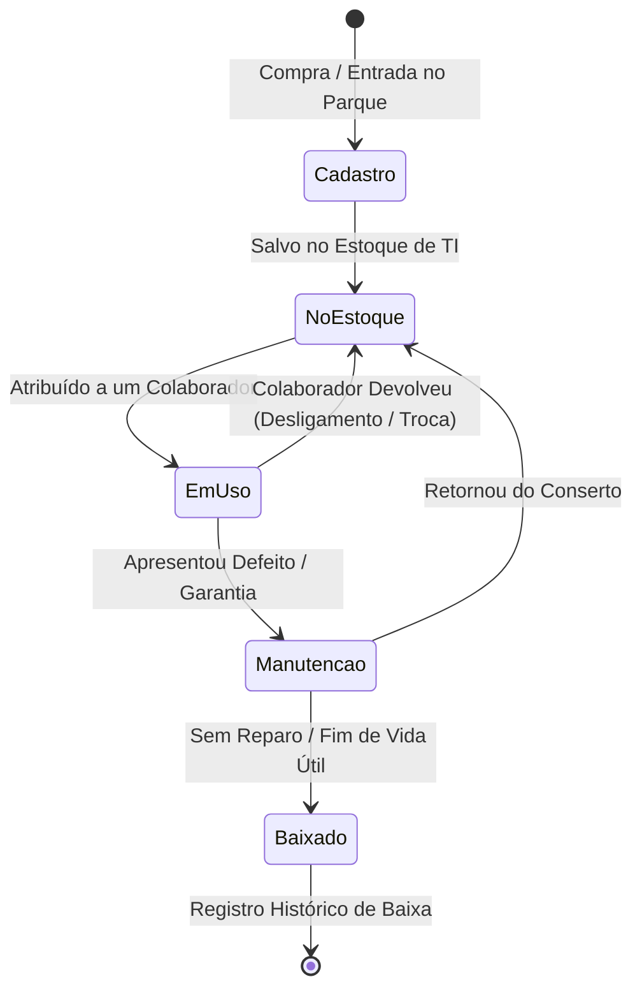
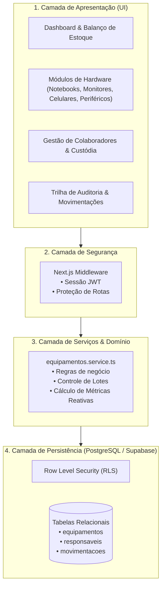
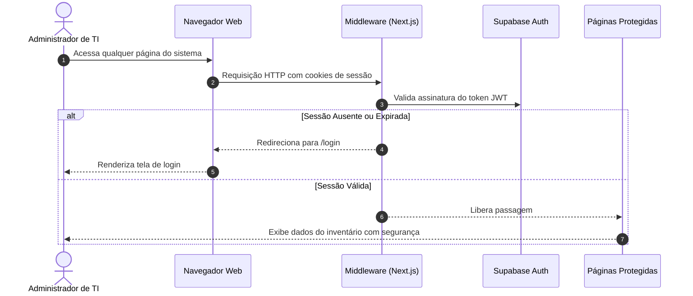

# 💻 Inventário de TI — Enterprise Asset Management & Hardware Governance


O **Inventário de TI** é uma plataforma corporativa web de alta performance projetada para substituir controles manuais e planilhas vulneráveis por uma gestão centralizada, segura e em tempo real do parque tecnológico de ativos (Notebooks, Monitores, Celulares Corporativos e Periféricos em lote).

Construída sob princípios de **Clean Architecture, Governança de TI e Compliance**, a plataforma rastreia o ciclo de vida completo de cada equipamento: desde o recebimento em estoque e controle volumétrico no almoxarifado até a custódia nominal por colaboradores, manutenções técnicas e baixas patrimoniais com trilha de auditoria imutável.

---

## 📑 Sumário

1. [Diferenciais de Negócio & Problemas Resolvidos](#-diferenciais-de-negócio--problemas-resolvidos)
2. [Módulos e Recursos da Aplicação](#-módulos-e-recursos-da-aplicação)
3. [Destaques de Engenharia e Arquitetura](#-destaques-de-engenharia-e-arquitetura)
4. [Diagramas da Aplicação (Mermaid)](#-diagramas-da-aplicação)
   - [Ciclo de Vida do Ativo](#a-ciclo-de-vida-de-um-ativo)
   - [Arquitetura em Camadas (Clean Architecture)](#b-arquitetura-em-camadas)
   - [Fluxo de Autenticação e Guarda de Rotas](#c-fluxo-de-autenticação-e-guarda-de-rotas)
5. [Design System & Interface Corporativa](#-design-system--interface-corporativa)
6. [Estrutura do Repositório](#-estrutura-do-repositório)
7. [Camadas de Segurança e Conformidade](#-camadas-de-segurança-e-conformidade)
8. [Como Executar o Projeto Localmente](#-como-executar-o-projeto-localmente)
9. [Configuração do Banco de Dados (Supabase)](#-configuração-do-banco-de-dados-supabase)

---

## 🎯 Diferenciais de Negócio & Problemas Resolvidos

Em empresas em crescimento, o controle de TI em planilhas ou ferramentas improvisadas traz riscos severos:
* **Falta de Visão Operacional (Estoque vs Em Uso)**: Dificuldade em responder de imediato quantos notebooks estão livres para novos funcionários e quantos estão alocados.
* **Complexidade no Controle de Periféricos**: Cabos, mouses e headsets são comprados em caixas/lotes e distribuídos individualmente sem número de série prévio, gerando furos de estoque.
* **Perda de Custódia em Desligamentos**: Ausência de registro nominal claro de quais equipamentos devem ser devolvidos no *offboarding* de um colaborador.
* **Insegurança e Vulnerabilidade de Dados**: Planilhas compartilhadas sem controle de acesso por perfil e sem trilha de auditoria contra adulterações.

O **Inventário de TI** soluciona todas essas dores combinando **regras de negócio refinadas** com uma **interface moderna e reativa**.

---

## ✨ Módulos e Recursos da Aplicação

### 1. 📊 Dashboard Analítico Executivo
* **Balanço por Categoria (Estoque vs Em Uso)**: Painel interativo com contadores em tempo real para **Notebooks**, **Monitores**, **Celulares** e **Periféricos**, exibindo a quantidade disponível em estoque versus a quantidade em posse de colaboradores.
* **Filtros Rápidos em 1 Clique**: Ao clicar na pílula *No Estoque* ou *Em Uso* de qualquer categoria, a tabela principal filtra imediatamente os equipamentos correspondentes.
* **Métrica de Taxa de Ocupação**: Barra proporcional do nível de alocação de cada tipo de equipamento no parque corporativo.
* **Indicadores Globais (KPIs)**: Total de equipamentos, total em uso, saldo disponível no estoque e ativos em assistência técnica.

### 2. 📦 Inventário Multi-Ativos & Gestão de Hardware
* **Notebooks Corporativos**: Ficha com Processador, Memória RAM, Armazenamento (SSD), Marca, Modelo e Número de Série.
* **Monitores**: Resolução de tela, tamanho em polegadas e portas de entrada (HDMI, DisplayPort, USB-C).
* **Celulares Corporativos**: Armazenamento, capacidade de bateria, número de linha móvel e operadora.
* **Periféricos com Controle de Lotes**:
  - Cadastro volumétrico no estoque (ex: lote de 15 headsets ou 20 mouses);
  - Decremento automático do almoxarifado no momento da entrega a um colaborador;
  - Campo opcional de número de série individual registrado na entrega.

### 3. 👥 Gestão de Colaboradores & Vínculo de Custódia
* **Catálogo de Pessoas**: Nome completo, e-mail corporativo, departamento e cargo.
* **Identificação Visual de Posse**: Badges elegantes com avatar e dados do colaborador vinculado ao equipamento.
* **Atribuição & Devolução com 1 Clique**: Modais integrados para alocar um equipamento do estoque a um funcionário ou registrar a devolução com motivo formal.
* **Exclusão Segura com Dupla Confirmação**: Proteção contra exclusões acidentais, com devolução automática de ativos ao estoque em caso de desligamento.

### 4. 📜 Trilha de Auditoria & Compliance Imutável
* **Histórico Completo de Movimentações**: Linha do tempo de todas as entradas, atribuições, devoluções, manutenções e baixas patrimoniais.
* **Registro de Responsabilidade**: Data/hora, motivo detalhado, responsável de origem, responsável de destino e assinatura digital do administrador que efetuou a ação.
* **Regra de Imutabilidade**: Históricos de movimentação protegidos contra edição ou exclusão arbitrária.

### 5. 🔐 Autenticação & Guarda de Rotas
* **Acesso Protegido via Supabase Auth**: Sessões criptografadas com tokens JWT e cookies seguros.
* **Middleware Interceptor (`src/middleware.ts`)**: Validação no lado do servidor impedindo que rotas internas sejam acessadas sem login válido.
* **Perfil do Administrador Dinâmico**: Nome e identidade visual sincronizados com a sessão ativa.

---

## 🛠️ Destaques de Engenharia e Arquitetura

* **App Router do Next.js 16 & React 19**: Server Components para performance e SEO aliados a Client Components reativos nos módulos interativos.
* **TypeScript Strict Mode**: Zero erros de compilação (`tsc --noEmit`), com tipagem forte para entidades de domínio (`Equipamento`, `Responsável`, `Movimentação`, `TipoEquipamento`).
* **Clean Data Access Layer (DAL)**: O serviço `equipamentos.service.ts` encapsula a comunicação com o Supabase e mantém fallback transparente em memória local para resiliência e resposta instantânea na interface.
* **Tailwind CSS v4 Design System**: Paleta corporativa customizada com base Índigo e ardósia escuro (*Dark Sidebar* `#0b0e24`, acentos `#4f46e5` e estados em `#10b981`).

---

## 🗺️ Diagramas da Aplicação

### a. Ciclo de Vida de um Ativo



### b. Arquitetura em Camadas



### c. Fluxo de Autenticação e Guarda de Rotas



---

## 🎨 Design System & Interface Corporativa

| Elemento | Especificação Visual |
| :--- | :--- |
| **Paleta Principal** | Tons Índigo (`indigo-600`, `indigo-700`, `indigo-950`) |
| **Barra Lateral** | Dark Theme Corporativo (`#0b0e24`) com gaveta expansível 100% clicável |
| **Estados de Ativo** | 🟢 No Estoque (`emerald-600`) • 🟣 Em Uso (`indigo-700`) • 🟡 Manutenção (`amber-600`) |
| **Cards de Colaborador** | Avatar com iniciais em índigo vibrante e selo de custódia nominal |
| **Tipografia** | Geist / Inter com alta legibilidade para números de série e especificações |

---

## 📁 Estrutura do Repositório

```text
inventario-ti/
├── src/
│   ├── app/                          # Rotas do Next.js (App Router)
│   │   ├── layout.tsx                # Layout corporativo com Sidebar e Header
│   │   ├── page.tsx                  # Dashboard principal com divisão Estoque vs Em Uso
│   │   ├── login/page.tsx            # Autenticação de administradores
│   │   ├── equipamentos/             # Módulo de Equipamentos
│   │   │   ├── page.tsx              # Listagem categorizada com filtros
│   │   │   ├── novo/page.tsx         # Formulário com suporte a lotes e hardware
│   │   │   └── [id]/page.tsx         # Ficha detalhada do ativo e histórico
│   │   ├── responsaveis/page.tsx     # Gestão de Colaboradores e custódia
│   │   ├── movimentacoes/page.tsx    # Linha do tempo de auditoria
│   │   └── configuracoes/page.tsx    # Configurações do sistema e perfil
│   │
│   ├── components/                   # Componentes modulares
│   │   ├── layout/                   # Sidebar expansível e Header
│   │   ├── ui/                       # Design System (Button, Modal, StatCard, Badge)
│   │   └── modules/                  # Vistas do Dashboard e Tabelas
│   │
│   ├── lib/                          # Clientes Supabase e utilitários
│   ├── services/                     # Serviços de domínio e regras de negócio
│   ├── types/                        # Tipagens TypeScript estritas
│   └── middleware.ts                 # Interceptor de segurança de rotas
│
├── supabase/
│   └── schema.sql                    # Script SQL com tabelas e políticas RLS
│
├── .env.example                      # Template seguro das variáveis de ambiente
└── package.json                      # Scripts e dependências do projeto
```

---

## 🛡️ Camadas de Segurança e Conformidade

1. **Repositório Seguro**: Nenhuma chave confidencial ou credencial exposta no código. Arquivos `.env.local` protegidos pelo `.gitignore`.
2. **Criptografia & Autenticação (Bcrypt + JWT)**: Autenticação gerenciada pelo Supabase Auth com renovação automática de tokens.
3. **Row Level Security (RLS)**: Políticas ativas no PostgreSQL garantem isolamento de permissões direto no banco de dados.
4. **Imutabilidade de Auditoria**: Instruções `DELETE` bloqueadas na tabela de movimentações para conformidade com normas de auditoria e compliance de TI.
5. **Sanitização & Validação**: Validação estrita de entradas tanto no frontend quanto no serviço de dados.

---

## 🚀 Como Executar o Projeto Localmente

### Pré-requisitos
* **Node.js**: Versão 18.17 ou superior.
* **Git**: Para clonar o repositório.

### Passo a Passo

```bash
# 1. Clone o repositório
git clone https://github.com/gabinethe/inventario-ti.git
cd inventario-ti

# 2. Instale as dependências
npm install

# 3. Configure as variáveis de ambiente
cp .env.example .env.local
# Preencha com sua URL e Anon Key do Supabase

# 4. Inicie o servidor local de desenvolvimento
npm run dev

# 5. Acesse no navegador
http://localhost:3000
```

---

## 🗄️ Configuração do Banco de Dados (Supabase)

1. Crie um projeto no [Supabase](https://supabase.com).
2. Acesse a aba **SQL Editor**.
3. Copie o script contido em [`supabase/schema.sql`](supabase/schema.sql) e cole no editor.
4. Clique em **Run** para criar as tabelas com suporte a múltiplos tipos de ativos e políticas de segurança RLS.

---

## 👩‍💻 Autora & Licença

Projeto desenvolvido por **Gabriela Chagas**.  
Distribuído sob licença MIT. Sinta-se à vontade para utilizar como referência ou base para novos projetos corporativos.
