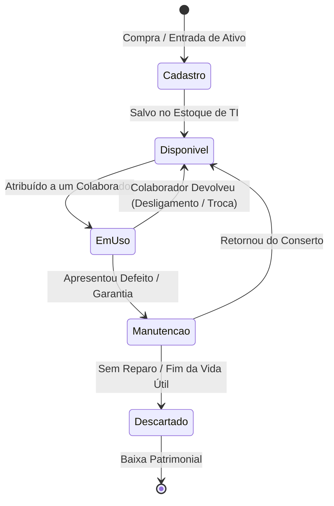
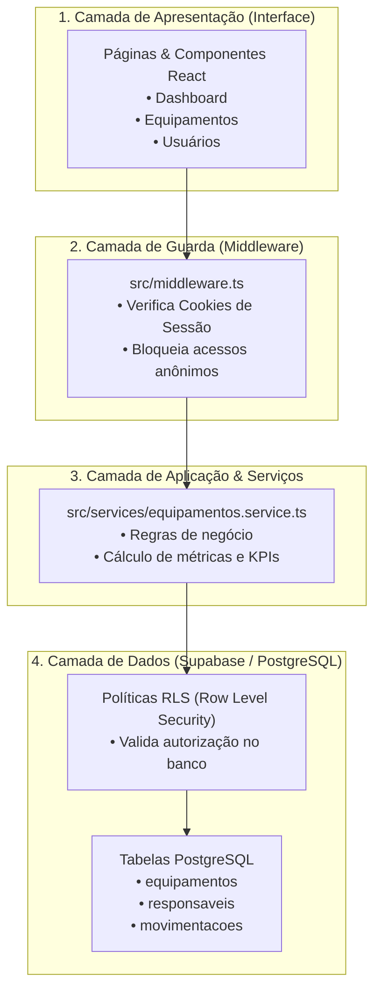
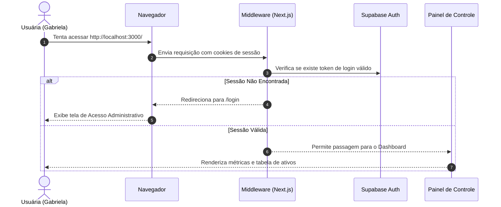

# 💻 Inventário de TI — Sistema Corporativo de Gestão de Ativos

Bem-vindo(a) à documentação do **Inventário de TI**, uma aplicação web corporativa desenvolvida para controle centralizado de equipamentos, rastreamento de responsáveis e auditoria de movimentações.

Este documento foi elaborado para servir como **guia de estudo e consulta técnica**, explicando de forma didática a arquitetura, o fluxo dos dados e a lógica de cada componente.

---

## 📑 Sumário
1. [Visão Geral & Stack Tecnológica](#1-visão-geral--stack-tecnológica)
2. [Fluxogramas da Aplicação (Mermaid)](#2-fluxogramas-da-aplicação)
   - [Fluxo de Vida de um Ativo](#a-ciclo-de-vida-de-um-ativo-notebook)
   - [Arquitetura em Camadas & Segurança](#b-arquitetura-em-camadas--segurança)
   - [Fluxo de Autenticação de Usuário](#c-fluxo-de-autenticação-e-guarda-de-rotas)
3. [Estrutura de Pastas e Responsabilidades](#3-estrutura-de-pastas-e-código)
4. [Camadas de Segurança e Boas Práticas](#4-camadas-de-segurança-adotadas)
5. [Guia de Configuração do Supabase (Banco de Dados)](#5-como-conectar-ao-supabase)
6. [Padrão de Commits Utilizado](#6-padrão-de-commits-git)

---

## 1. Visão Geral & Stack Tecnológica

O sistema foi construído utilizando tecnologias modernas e consagradas da indústria:

* **Next.js (App Router)**: Framework React full-stack que gerencia rotas, renderização híbrida no servidor (RSC) e chamadas seguras.
* **React**: Biblioteca para construção de interfaces componentizadas e reativas.
* **TypeScript**: Adiciona tipagem estática ao código JavaScript, prevenindo erros de digitação e facilitando o autocompletar.
* **Tailwind CSS (v4)**: Framework de estilização por classes utilitárias para interfaces modernas e responsivas.
* **Lucide React**: Biblioteca de ícones SVG limpos e padronizados.
* **Supabase**: Backend-as-a-Service com banco de dados relacional **PostgreSQL**, autenticação pronta e políticas **RLS (Row Level Security)**.
* **Git**: Controle de versão profissional para registro histórico das alterações.

---

## 2. Fluxogramas da Aplicação

### a. Ciclo de Vida de um Ativo (Notebook)

Mostra os estados pelos quais um equipamento pode passar dentro da empresa:



### b. Arquitetura em Camadas & Segurança

Mostra como uma requisição trafega da tela até o banco de dados sem acoplamento:



### c. Fluxo de Autenticação e Guarda de Rotas

Explica como o porteiro de segurança decide se o usuário pode ou não ver as telas:



---

## 3. Estrutura de Pastas e Código

```text
inventario-ti/
├── src/
│   ├── app/                          # Rotas e Páginas (Next.js App Router)
│   │   ├── (auth)/                   # Telas públicas de acesso
│   │   │   └── login/page.tsx        # Tela de Login com E-mail e Senha
│   │   ├── layout.tsx                # Casca visual compartilhada (inclui a Sidebar)
│   │   ├── page.tsx                  # Dashboard principal com KPIs e busca
│   │   ├── equipamentos/             # Módulo de Equipamentos
│   │   │   ├── page.tsx              # Tabela com busca em tempo real e filtros
│   │   │   ├── novo/page.tsx         # Formulário de entrada de novo notebook
│   │   │   └── [id]/page.tsx         # Ficha de detalhes, hardware e histórico
│   │   ├── responsaveis/             # Módulo de Usuários / Colaboradores
│   │   │   ├── page.tsx              # Lista de colaboradores e ativos em posse
│   │   │   └── novo/page.tsx         # Formulário de cadastro de novo colaborador
│   │   ├── movimentacoes/page.tsx    # Linha do tempo de auditoria (transferências)
│   │   └── configuracoes/page.tsx    # Parâmetros de TI e status do sistema
│   │
│   ├── components/                   # Peças visuais reutilizáveis
│   │   ├── layout/                   # Componentes de estrutura fixa
│   │   │   ├── sidebar.tsx           # Menu lateral azul-marinho com links
│   │   │   └── header.tsx            # Barra superior com usuário e notificações
│   │   ├── ui/                       # Componentes primitivos (Design System)
│   │   │   ├── button.tsx            # Botões (Primary, Outline, Ghost)
│   │   │   ├── input.tsx             # Campos de texto e números estilizados
│   │   │   ├── stat-card.tsx         # Cards dos indicadores do Dashboard
│   │   │   └── badge.tsx             # Etiquetas coloridas de status do ativo
│   │   └── modules/                  # Componentes específicos de cada tela
│   │       ├── dashboard/            # Visão interativa do painel inicial
│   │       └── equipamentos/         # Tabela interativa de busca
│   │
│   ├── lib/                          # Clientes externos e utilitários
│   │   ├── supabase/                 # Helpers de conexão com o Supabase
│   │   │   ├── client.ts             # Cliente para uso no navegador
│   │   │   ├── server.ts             # Cliente para uso no servidor
│   │   │   └── middleware.ts         # Atualizador de sessão para o middleware
│   │   └── utils.ts                  # Função `cn` para merge condicional do Tailwind
│   │
│   ├── services/                     # Lógica de Negócio e Acesso a Dados (DAL)
│   │   ├── equipamentos.service.ts   # Funções assíncronas (listar, criar, metricas)
│   │   └── mock-data.ts              # Dados de exemplo para uso offline/local
│   │
│   ├── types/                        # Definições de Tipos TypeScript
│   │   ├── equipamento.ts            # Modelo de dados de Notebooks
│   │   ├── responsavel.ts            # Modelo de dados de Colaboradores
│   │   └── movimentacao.ts           # Modelo de dados do Histórico
│   │
│   └── middleware.ts                 # Interceptor de segurança central
│
├── supabase/
│   └── schema.sql                    # Script SQL completo com tabelas, RLS e dados iniciais
│
├── .env.example                      # Modelo das chaves de ambiente necessárias
├── postcss.config.mjs                # Configuração do PostCSS para o Tailwind CSS v4
└── package.json                      # Dependências e scripts do projeto
```

---

## 4. Camadas de Segurança Adotadas

1. **Separação de Chaves**:
   - `NEXT_PUBLIC_SUPABASE_ANON_KEY`: Chave pública permitida no navegador, protegida obrigatoriamente por **Row Level Security (RLS)** no banco de dados.
   - Chaves de serviço restritas ficam estritamente no servidor.
2. **Row Level Security (RLS)**:
   - Configurado no arquivo [`supabase/schema.sql`](file:///D:/Users/gabriela.chagas/.gemini/antigravity/scratch/inventario-ti/supabase/schema.sql).
   - Impede que usuários não autenticados possam modificar, inserir ou deletar registros diretamente via API.
3. **Auditoria Imutável**:
   - A tabela `movimentacoes` possui uma política específica que bloqueia instruções `DELETE`. Nenhum registro histórico pode ser apagado, garantindo conformidade para auditorias de TI.
4. **Middleware Guardião**:
   - Localizado em `src/middleware.ts`, intercepta as requisições antes que a página seja processada, redirecionando usuários anônimos para o login.

---

## 5. Como Conectar ao Supabase

1. Crie uma conta gratuita em [supabase.com](https://supabase.com) (usando seu GitHub).
2. Clique em **"New Project"** e escolha um nome (ex: `inventario-ti`).
3. No menu lateral do Supabase, clique em **SQL Editor** > **New Query**.
4. Copie todo o conteúdo do arquivo [`supabase/schema.sql`](file:///D:/Users/gabriela.chagas/.gemini/antigravity/scratch/inventario-ti/supabase/schema.sql) deste projeto, cole no editor do Supabase e clique em **Run**.
   - As 3 tabelas serão criadas com as regras de segurança e dados de exemplo!
5. No menu do Supabase, vá em **Project Settings** > **API**:
   - Copie a **Project URL** e a **anon public Key**.
6. Crie um arquivo chamado `.env.local` na raiz deste projeto com:
   ```env
   NEXT_PUBLIC_SUPABASE_URL=https://seu-id-aqui.supabase.co
   NEXT_PUBLIC_SUPABASE_ANON_KEY=sua-chave-anon-aqui
   ```
7. Pronto! Seu sistema estará conectado a um banco de dados relacional na nuvem.

---

## 6. Padrão de Commits Git

Utilizamos o padrão **Conventional Commits** para manter o histórico de versionamento limpo e autoexplicativo:

* **`feat:`** (Feature): Nova funcionalidade adicionada ao sistema.
  - *Exemplo*: `feat: adiciona formulario de cadastro de colaborador`
* **`fix:`** (Correção): Ajuste de algum bug ou problema de estilo.
  - *Exemplo*: `fix: corrige configuracao do postcss para o tailwind v4`
* **`docs:`** (Documentação): Atualizações no README ou comentários explicativos.
  - *Exemplo*: `docs: documentacao completa em portugues e fluxogramas`
* **`refactor:`** (Refatoração): Melhoria no código sem alterar o comportamento visual.
