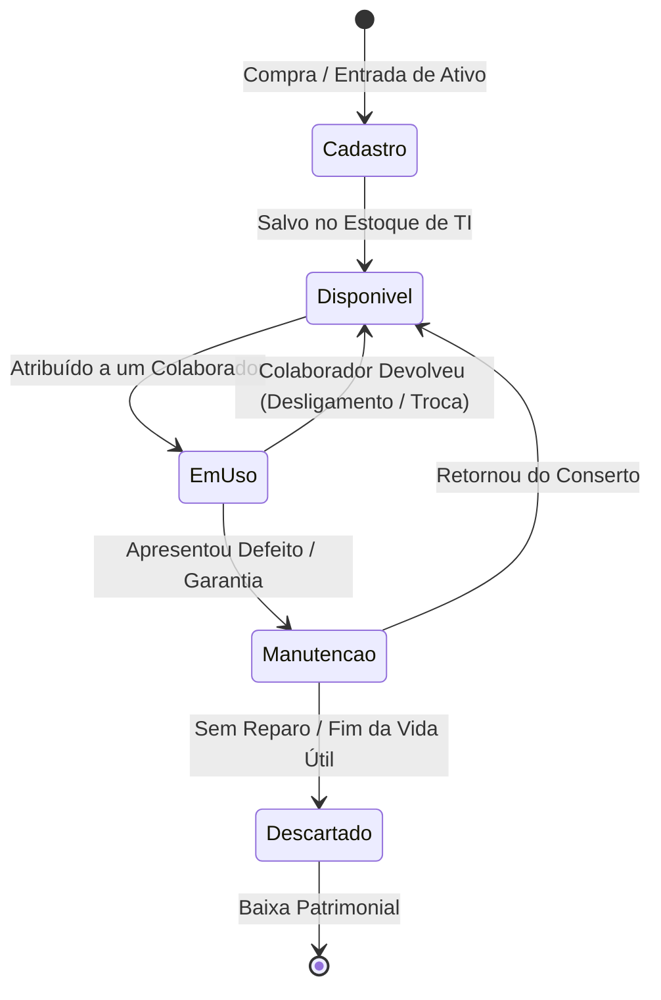
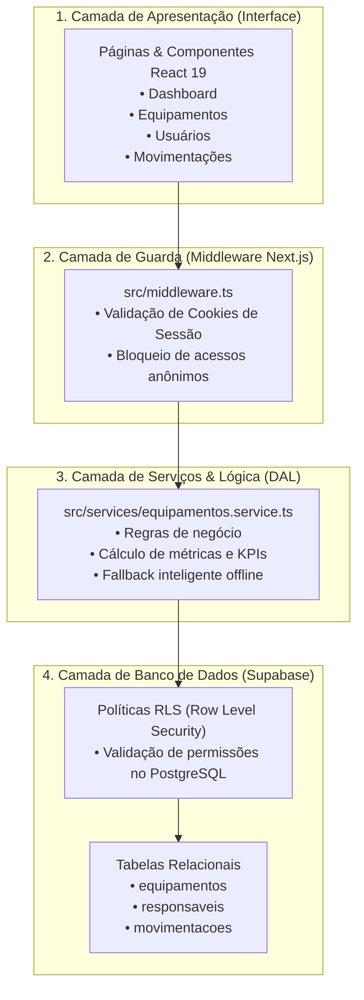
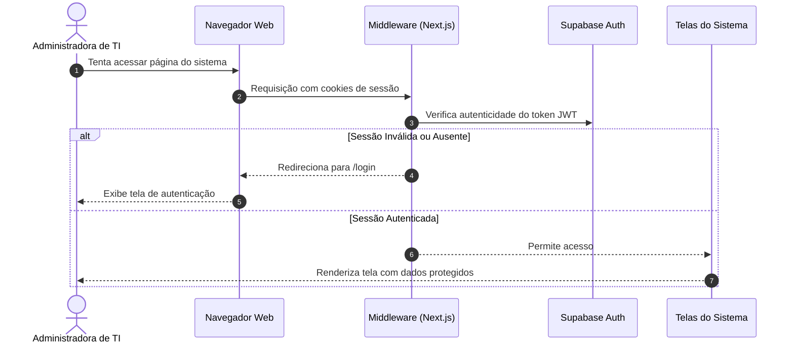

# 💻 Inventário de TI — Sistema Corporativo de Gestão de Ativos


O **Inventário de TI** é uma plataforma corporativa web desenvolvida para substituir o controle manual e vulnerável de planilhas por uma gestão centralizada, rastreável e segura do parque tecnológico de computadores (notebooks e equipamentos de trabalho).

Projetada com arquitetura escalável e foco em **governança de TI, auditoria e compliance**, a solução permite monitorar o ciclo de vida completo de cada ativo: desde a compra e alocação a colaboradores até devoluções, manutenções e descarte patrimonial.

---

## 📑 Sumário

1. [Problema Resolvido](#-o-problema-resolvido)
2. [Principais Funcionalidades](#-principais-funcionalidades)
3. [Fluxogramas da Aplicação (Mermaid)](#-fluxogramas-da-aplicação)
   - [Ciclo de Vida do Ativo](#a-ciclo-de-vida-de-um-ativo-notebook)
   - [Arquitetura em Camadas](#b-arquitetura-em-camadas--fluxo-de-dados)
   - [Fluxo de Autenticação e Guarda de Rotas](#c-fluxo-de-autenticação-e-guarda-de-rotas)
4. [Estrutura de Pastas e Código](#-estrutura-de-pastas-e-código)
5. [Camadas de Segurança e Conformidade](#-camadas-de-segurança-e-conformidade)
6. [Guia de Configuração e Execução Local](#-como-executar-o-projeto-localmente)
7. [Configuração do Banco de Dados (Supabase)](#-configuração-do-banco-de-dados-supabase)

---

## 🎯 O Problema Resolvido

Em muitas empresas, o controle de computadores corporativos é feito em planilhas decentralizadas que sofrem com:
* **Perda de Rastreabilidade**: Não saber exatamente com qual colaborador uma máquina está após trocas ou demissões.
* **Falta de Histórico de Manutenção**: Ausência de registro de quantas vezes um notebook deu defeito ou foi para conserto.
* **Insegurança de Dados**: Planilhas com links abertos, sem controle de acesso por permissão ou autenticação.
* **Cálculo Financeiro Manual**: Dificuldade em apurar o valor total em dinheiro investido nas máquinas ativas da organização.

O **Inventário de TI** resolve todas essas dores através de um sistema robusto, com banco de dados relacional e controle rigoroso de custódia.

---

## ✨ Principais Funcionalidades

### 1. 📊 Dashboard Executivo & KPIs
* **Contadores em Tempo Real**: Total de equipamentos, máquinas ativas com colaboradores, estoque disponível para novos contratados e equipamentos em manutenção.
* **Métrica Financeira Consolidada**: Cálculo automático do valor patrimonial total do parque de máquinas.
* **Visão Rápida**: Listagem dos últimos ativos cadastrados com atalhos de busca instantânea e filtros por status.

### 2. 💻 Gestão de Equipamentos (Notebooks)
* **Ficha Técnica Detalhada**: Armazenamento de Marca, Modelo, Patrimônio, Número de Série, Processador, Memória RAM e Armazenamento (SSD).
* **Filtros por Estado Operacional**: *Disponível*, *Em Uso*, *Em Manutenção* e *Descartado*.
* **Busca Global Instantânea**: Pesquisa por patrimônio, número de série, modelo ou nome do colaborador em posse.
* **Formulário de Cadastro**: Validação e persistência de novas entradas patrimoniais com valores de aquisição e observações técnicas.

### 3. 👥 Gestão de Colaboradores & Custódia
* **Catálogo de Usuários**: Cadastro de colaboradores com Nome, E-mail, Departamento e Cargo.
* **Vínculo Direto de Custódia**: Visualização imediata de qual notebook está sob a responsabilidade de cada funcionário.
* **Histórico de Posse**: Rastreamento de entregas e devoluções vinculadas ao colaborador.

### 4. 🔄 Auditoria Imutável de Movimentações
* **Linha do Tempo Completa**: Registro cronológico de todas as atribuições, trocas, devoluções e envios para assistência técnica.
* **Campos de Compliance**: Data e hora exatas, motivo da movimentação, responsável de origem, responsável de destino e identificação de quem registrou a operação.
* **Regra de Imutabilidade**: Movimentações não podem ser apagadas do banco de dados, servindo como registro oficial para auditorias externas e internas.

### 5. 🔐 Controle de Acesso Administrativo
* **Tela de Login Corporativa**: Autenticação segura através de e-mail e senha gerenciados pelo Supabase Auth.
* **Middleware Guardião (Proxy)**: Proteção automática de todas as rotas internas, impedindo que pessoas não autorizadas acessem painéis do sistema sem autenticação.

---

## 🗺️ Fluxogramas da Aplicação

### a. Ciclo de Vida de um Ativo (Notebook)

Mostra os estados controlados pelo sistema desde a compra até a baixa patrimonial:



### b. Arquitetura em Camadas & Fluxo de Dados

Organização limpa do software que separa a interface gráfica, as regras de negócio e o armazenamento no banco:



### c. Fluxo de Autenticação e Guarda de Rotas

Fluxo de segurança executado a cada tentativa de navegação no sistema:



---

## 📁 Estrutura de Pastas e Código

```text
inventario-ti/
├── src/
│   ├── app/                          # Rotas e Páginas (Next.js App Router)
│   │   ├── layout.tsx                # Layout mestre corporativo com barra lateral
│   │   ├── page.tsx                  # Dashboard principal com métricas e busca
│   │   ├── login/page.tsx            # Tela de autenticação de administrador
│   │   ├── equipamentos/             # Módulo de Equipamentos
│   │   │   ├── page.tsx              # Tabela geral de notebooks e filtros
│   │   │   ├── novo/page.tsx         # Formulário de entrada de novo notebook
│   │   │   └── [id]/page.tsx         # Ficha individual de hardware e histórico
│   │   ├── responsaveis/             # Módulo de Colaboradores
│   │   │   ├── page.tsx              # Lista de colaboradores e ativos em posse
│   │   │   └── novo/page.tsx         # Formulário de cadastro de novo colaborador
│   │   ├── movimentacoes/page.tsx    # Linha do tempo de auditoria
│   │   └── configuracoes/page.tsx    # Informações técnicas e status do ambiente
│   │
│   ├── components/                   # Componentes Visuais Reutilizáveis
│   │   ├── layout/                   # Estrutura fixa (Sidebar azul e Header)
│   │   ├── ui/                       # Design System (Button, Input, Badge, StatCard)
│   │   └── modules/                  # Componentes dedicados de páginas
│   │
│   ├── lib/                          # Conectores e Clientes de Infraestrutura
│   │   ├── supabase/                 # Clientes Supabase (Navegador, Servidor e Middleware)
│   │   └── utils.ts                  # Utilitários de classes CSS
│   │
│   ├── services/                     # Camada de Acesso a Dados e Regras de Negócio
│   │   ├── equipamentos.service.ts   # Operações de CRUD com fallback em memória
│   │   └── mock-data.ts              # Dados de demonstração inicial
│   │
│   ├── types/                        # Tipagens TypeScript (Equipamento, Responsável, etc.)
│   └── middleware.ts                 # Interceptor central de segurança
│
├── supabase/
│   └── schema.sql                    # Script SQL completo de tabelas e políticas RLS
│
├── .env.example                      # Template seguro das variáveis de ambiente
└── package.json                      # Dependências do projeto
```

---

## 🛡️ Camadas de Segurança e Conformidade

1. **Repositório Seguro & Segregação de Credenciais**:
   - Nenhum segredo ou chave privada de servidor é armazenado no Git. Arquivos de ambiente (`.env.local`) são ignorados pelo `.gitignore`.
2. **Criptografia de Senhas (Bcrypt)**:
   - A autenticação é delegada ao Supabase Auth, que armazena credenciais com hash seguro e fornece tokens assinados com renovação automática.
3. **Proteção por Row Level Security (RLS)**:
   - O banco PostgreSQL possui políticas ativas em cada tabela, garantindo que as operações ocorram de acordo com as regras de permissão.
4. **Imutabilidade de Registros de Auditoria**:
   - A tabela de movimentações possui uma política de segurança explícita que bloqueia instruções `DELETE`. Uma vez gravado o histórico de um equipamento, ele nunca pode ser adulterado.
5. **Cookies HttpOnly e Middleware Guardião**:
   - As sessões são validadas pelo `src/middleware.ts` no lado do servidor antes que qualquer conteúdo confidencial seja renderizado para o navegador.

---

## 🚀 Como Executar o Projeto Localmente

### Pré-requisitos
* **Node.js**: Versão 18.17 ou superior instalada.
* **Git**: Para clonar o repositório.

### Passo a Passo

1. **Clonar o Repositório:**
   ```bash
   git clone https://github.com/gabinethe/inventario-ti.git
   cd inventario-ti
   ```

2. **Instalar Dependências:**
   ```bash
   npm install
   ```

3. **Configurar as Variáveis de Ambiente:**
   Copie o arquivo de exemplo e crie o seu `.env.local`:
   ```bash
   cp .env.example .env.local
   ```
   Preencha as chaves com os dados do seu projeto no Supabase:
   ```env
   NEXT_PUBLIC_SUPABASE_URL=https://seu-projeto.supabase.co
   NEXT_PUBLIC_SUPABASE_ANON_KEY=sua-chave-publica-anon
   ```

4. **Iniciar o Servidor de Desenvolvimento:**
   ```bash
   npm run dev
   ```

5. **Acessar a Aplicação:**
   Abra no seu navegador: **[http://localhost:3000](http://localhost:3000)**

---

## 🗄️ Configuração do Banco de Dados (Supabase)

Para inicializar a estrutura do banco com tabelas, políticas de segurança e dados iniciais:

1. Crie um projeto em [supabase.com](https://supabase.com).
2. Acesse a aba **SQL Editor** no painel do Supabase.
3. Copie o conteúdo do arquivo [`supabase/schema.sql`](supabase/schema.sql) deste repositório e cole no editor.
4. Execute o script clicando em **Run**.
5. As tabelas `equipamentos`, `responsaveis` e `movimentacoes` estarão criadas e prontas para uso!

---

*Desenvolvido com foco em excelência técnica, código limpo e conformidade corporativa.*
