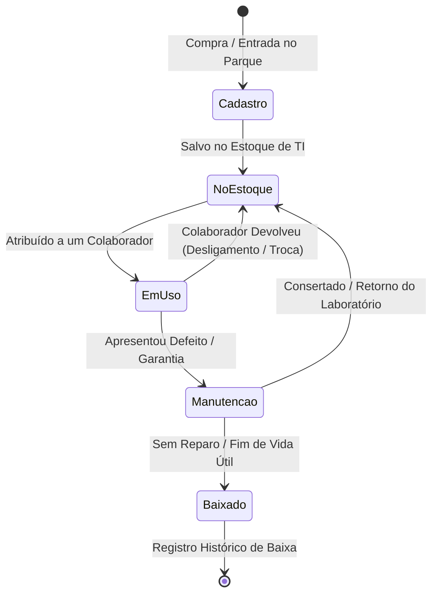
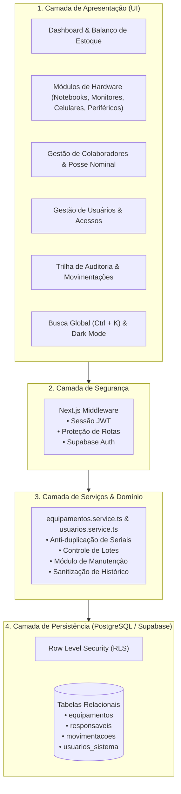
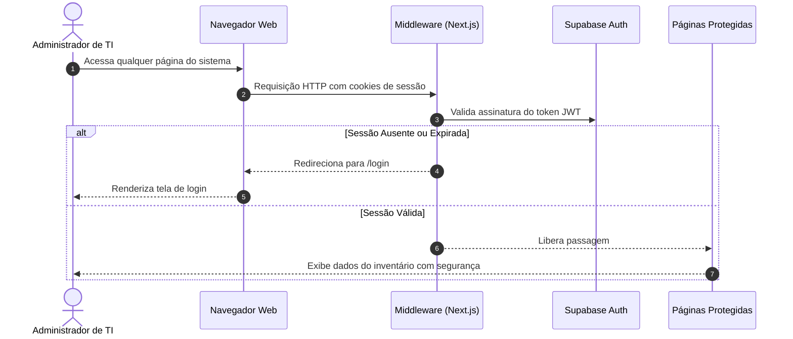

# 💻 Inventário de TI — Enterprise Asset Management & Hardware Governance


O **Inventário de TI** é uma plataforma corporativa web de alta performance projetada para substituir controles manuais e planilhas vulneráveis por uma gestão centralizada, segura e em tempo real do parque de tecnologia (Notebooks, Monitores, Celulares Corporativos e Periféricos em lote).

Construída sob princípios de **Clean Architecture, Governança de TI e Compliance**, a plataforma rastreia o ciclo de vida completo de cada equipamento: desde o recebimento em estoque e controle volumétrico no almoxarifado até a custódia nominal por colaboradores, manutenções técnicas e baixas patrimoniais com trilha de auditoria imutável.

---

## 📑 Sumário

1. [Diferenciais de Negócio & Problemas Resolvidos](#-diferenciais-de-negócio--problemas-resolvidos)
2. [Guia Completo de Funcionalidades (O Que Faz, Por Que Existe e Como Funciona)](#-guia-completo-de-funcionalidades)
   - [1. Dashboard Executivo & Métricas de Saúde do Estoque](#1-dashboard-executivo--métricas-de-saúde-do-estoque)
   - [2. Gestão do Parque de Ativos & Categorização Especializada](#2-gestão-do-parque-de-ativos--categorização-especializada)
   - [3. Regras de Unicidade e Validação Rigorosa de Dados](#3-regras-de-unicidade-e-validação-rigorosa-de-dados)
   - [4. Roteamento Contextual de Cadastro de Equipamentos](#4-roteamento-contextual-de-cadastro-de-equipamentos)
   - [5. Módulo de Manutenção Técnica & Assistência](#5-módulo-de-manutenção-técnica--assistência)
   - [6. Barra de Pesquisa Global Inteligente (`Ctrl + K`)](#6-barra-de-pesquisa-global-inteligente-ctrl--k)
   - [7. Sistema de Temas (Modo Claro & Modo Escuro / Dark Mode)](#7-sistema-de-temas-modo-claro--modo-escuro)
   - [8. Sidebar Minimizável com Tooltips & Ergonomia Visual](#8-sidebar-minimizável-com-tooltips--ergonomia-visual)
   - [9. Gestão de Colaboradores & Posse Nominal](#9-gestão-de-colaboradores--posse-nominal)
   - [10. Gestão de Usuários do Sistema & Supabase Auth Autêntico](#10-gestão-de-usuários-do-sistema--supabase-auth-autêntico)
   - [11. Trilha Imutável de Auditoria & Sanitização de Dados](#11-trilha-imutável-de-auditoria--sanitização-de-dados)
   - [12. Design Responsivo & Aproveitamento de Tela](#12-design-responsivo--aproveitamento-de-tela)
3. [Destaques de Engenharia e Arquitetura](#-destaques-de-engenharia-e-arquitetura)
4. [Diagramas da Aplicação (Mermaid)](#-diagramas-da-aplicação)
   - [Ciclo de Vida do Ativo](#a-ciclo-de-vida-de-um-ativo)
   - [Arquitetura em Camadas (Clean Architecture)](#b-arquitetura-em-camadas)
   - [Fluxo de Autenticação e Guarda de Rotas](#c-fluxo-de-autenticação-e-guarda-de-rotas)
5. [Design System & Interface Corporativa](#-design-system--interface-corporativa)
6. [Estrutura do Repositório](#-estrutura-do-repositório)
7. [Camadas de Segurança e Conformidade](#-camadas-de-segurança-e-conformidade)
8. [Como Executar o Projeto Localmente](#-como-executar-o-projeto-localmente)
9. [Configuração do Banco de Dados (Supabase)](#-configuração-do-banco-de-dados-supabase)

---

## 🎯 Diferenciais de Negócio & Problemas Resolvidos

Em empresas em crescimento, o controle de TI em planilhas ou ferramentas improvisadas traz riscos severos:
* **Falta de Visão Operacional (Estoque vs Em Uso)**: Dificuldade em responder de imediato quantos notebooks estão livres para novos funcionários e quantos estão alocados.
* **Complexidade no Controle de Periféricos**: Cabos, mouses e headsets são comprados em caixas/lotes e distribuídos individualmente sem número de série prévio, gerando furos de estoque.
* **Perda de Custódia em Desligamentos**: Ausência de registro nominal claro de quais equipamentos devem ser devolvidos no *offboarding* de um colaborador.
* **Insegurança e Vulnerabilidade de Dados**: Planilhas compartilhadas sem controle de acesso por perfil e sem trilha de auditoria contra adulterações.
* **Ativos Perdidos em Manutenção**: Dificuldade em controlar quais máquinas foram enviadas para conserto/garantia, o motivo do chamado e o fornecedor responsável.

O **Inventário de TI** soluciona todas essas dores combinando **regras de negócio refinadas** com uma **interface moderna, reativa e ergonômica**.

---

## 🚀 Guia Completo de Funcionalidades

Esta seção detalha cada funcionalidade implementada no sistema, o **motivo de negócio** de sua existência e o **mecanismo técnico** de seu funcionamento.

---

### 1. Dashboard Executivo & Métricas de Saúde do Estoque
* **O que faz**: Apresenta uma visão consolidada de alto nível sobre todo o ecossistema tecnológico da empresa, sem atalhos perdidos ou elementos fora de contexto.
* **Motivo**: Gestores de TI precisam responder instantaneamente: *"Temos notebooks suficientes para as 5 contratações da próxima semana?"* ou *"Qual a taxa de ociosidade dos nossos monitores?"*.
* **Como funciona**:
  - **KPIs em Tempo Real**: Total de Ativos, Ativos em Custódia (Em Uso), Saldo em Estoque e Itens em Manutenção.
  - **Balanço por Categoria**: Indicador dividido para Notebooks, Monitores, Celulares e Periféricos com contadores de estoque, em uso e barra de taxa de ocupação percentual.
  - **Prontidão de Onboarding**: Diagnóstico instantâneo que avisa se a TI está pronta para equipar novos colaboradores com kit completo (Notebook + Monitor + Periférico).
  - **Tabela Resumo Direta**: Visão limpa dos últimos ativos cadastrados com link de 1 clique para detalhamento.

---

### 2. Gestão do Parque de Ativos & Categorização Especializada
* **O que faz**: Centraliza a listagem e o gerenciamento de todos os tipos de equipamentos em abas e filtros contextuais.
* **Motivo**: Cada tipo de hardware possui atributos vitais distintos (ex: notebook tem processador e RAM; celular tem operadora e chip; periféricos têm volume em lote).
* **Como funciona**:
  - **Abas Dedicadas**: Notebooks, Monitores, Celulares, Periféricos e aba consolidada "Todos os Ativos" posicionada harmonicamente no final.
  - **Controle de Lotes de Periféricos**: Permite cadastrar lotes volumétricos (ex: 20 mouses ou 15 headsets). Na entrega a um colaborador, o saldo disponível é decrementado automaticamente, com opção de registrar o número de série individual na entrega.
  - **Filtros Rápidos de Status**: Filtros em um clique para "Todos", "Disponíveis (Estoque)", "Em Uso (Custódia)" e "Em Manutenção".

---

### 3. Regras de Unicidade e Validação Rigorosa de Dados
* **O que faz**: Bloqueia o salvamento de qualquer equipamento caso haja campos obrigatórios em branco ou tentativa de duplicar um número de série/IMEI já registrado.
* **Motivo**: Erros de digitação ou cadastros em duplicidade corrompem auditorias, confundem garantias e causam perda de controle patrimonial.
* **Como funciona**:
  - **Validação em Tempo Real**: Ao digitar o Serial Number (`numeroSerie`), o sistema consulta a base existente e emite alerta visual imediato se o código já pertencer a outro ativo.
  - **Trava de Submissão**: O botão de envio fica desabilitado com feedback visual explicativo até que a inconsistência seja sanada.
  - **Obrigatoriedade Inteligente**: Campos técnicos fundamentais (Marca, Modelo, Serial, Especificações) são estritamente requeridos para computadores e celulares, enquanto periféricos em lote permitem serial opcional no momento da entrada.

---

### 4. Roteamento Contextual de Cadastro de Equipamentos
* **O que faz**: Ajusta dinamicamente a ação de cadastro com base na tela em que o operador se encontra.
* **Motivo**: Remove o botão estático e redundante "Cadastrar Notebook" que antes aparecia fixo em todas as páginas, inclusive na tela de periféricos ou monitores.
* **Como funciona**:
  - Se o operador estiver na aba de Monitores e clicar em "+ Cadastrar Monitor", a aplicação navega para `/equipamentos/novo?tipo=monitor`.
  - O formulário lê os parâmetros de busca (`searchParams.get("tipo")`), pré-seleciona a categoria correspondente, carrega as marcas do segmento (ex: LG, Dell, AOC) e renderiza as especificações técnicas adequadas (ex: polegadas, resolução e portas de vídeo).
  - Títulos, subtítulos e textos de confirmação ajustam-se contextualmente (`Cadastrar Monitor`, `Cadastrar Celular`, `Cadastrar Periférico`).

---

### 5. Módulo de Manutenção Técnica & Assistência
* **O que faz**: Permite registrar o envio de equipamentos com avarias para reparo interno ou assistência técnica autorizada, assim como o seu retorno ao estoque após o conserto.
* **Motivo**: Máquinas com problemas não podem constar como "Disponíveis" para entrega a novos funcionários e nem devem permanecer atreladas ao colaborador anterior.
* **Como funciona**:
  - **Abertura de Chamado**: Através do modal `ModalManutencao`, o operador informa o motivo do envio, laudo prévio e o laboratório/fornecedor encarregado.
  - **Atualização de Estado**: O status do ativo muda instantaneamente para `manutencao`. Se o equipamento estava em uso, sua custódia anterior é finalizada.
  - **Retorno ao Estoque**: Um botão de ação rápida "Finalizar Manutenção" registra a conclusão do serviço e move o equipamento de volta para `disponivel` no almoxarifado.
  - **Auditoria Automática**: Cada transição é registrada na trilha de auditoria com data, hora e responsável.

---

### 6. Barra de Pesquisa Global Inteligente (`Ctrl + K`)
* **O que faz**: Substitui o ícone estático de notificação por uma barra de busca rápida (*Quick Finder*) acessível por atalho de teclado global.
* **Motivo**: Acelera o fluxo de trabalho do time de TI, permitindo encontrar qualquer ativo, colaborador ou número de série em menos de 2 segundos sem navegar manualmente de tela em tela.
* **Como funciona**:
  - **Ativação por Atalho**: Pressionar `Ctrl + K` (ou `Cmd + K` no Mac) foca instantaneamente na barra de pesquisa superior; pressionar `Esc` limpa e fecha o menu suspenso.
  - **Busca Omnibox Indexada**: Digitar palavras-chave busca simultaneamente em:
    - **Ativos de TI**: Marca, modelo, número de série, patrimônio e especificações.
    - **Colaboradores**: Nome completo, e-mail corporativo, cargo e departamento.
    - **Navegação & Módulos**: Atalhos diretos para Dashboard, Equipamentos, Colaboradores, Auditoria e Configurações.
  - **Dropdown Flutuante Categorizado**: Apresenta resultados agrupados com badges visuais de status e links diretos para a ficha completa.

---

### 7. Sistema de Temas (Modo Claro & Modo Escuro / Dark Mode)
* **O que faz**: Permite que o usuário alterne livremente entre modo claro e modo escuro através de um botão com ícone interativo de Sol/Lua no cabeçalho.
* **Motivo**: Proporciona ergonomia visual para longos períodos de operação, reduz fadiga ocular em ambientes de pouca luz e atende à preferência estética dos profissionais de tecnologia.
* **Como funciona**:
  - **Contexto Reativo (`ThemeProvider`)**: Gerencia o estado do tema em `src/context/theme-context.tsx` e persiste a escolha no `localStorage`.
  - **Prevenção de Flicker (FOUC)**: Script inline no `<head>` de `src/app/layout.tsx` avalia a preferência salva ou a configuração do sistema operacional antes da renderização do DOM, evitando "piscar" de cores.
  - **Suporte Nativo Tailwind CSS v4**: Utiliza a diretiva `@custom-variant dark (&:where(.dark, .dark *));` em `src/app/globals.css`, aplicando paleta escura profunda (`#070913`, `#0f142b`, `#0b0f19`) e bordas harmônicas (`indigo-950/70`) em todos os componentes.

---

### 8. Sidebar Minimizável com Tooltips & Ergonomia Visual
* **O que faz**: Barra lateral retrátil que pode ser recolhida para o modo compacto (apenas ícones) ou expandida para o modo completo com um clique.
* **Motivo**: Libera espaço valioso na tela para visualização de tabelas densas de hardware e auditoria, sem perder a identidade nem a acessibilidade dos menus.
* **Como funciona**:
  - **Empilhamento Vertical Inteligente**: Quando minimizada, o logotipo corporativo e o botão de toggle ficam perfeitamente centralizados e alinhados um em cima do outro, eliminando o aperto horizontal anterior.
  - **Tooltips Flutuantes sem Corte**: A sidebar minimizada utiliza `overflow-x-visible`, permitindo que os tooltips flutuantes (`absolute left-[76px]`) ultrapassem a borda da barra lateral sem serem cortados pelo overflow.
  - **Acessibilidade**: Atributos `title` nativos presentes em todos os links garantem leitura imediata ao passar o mouse.
  - **Gaveta 100% Clicável**: A caixa do menu "Inventário de Ativos" é totalmente clicável em sua área inteira, e não apenas no pequeno ícone de seta.

---

### 9. Gestão de Colaboradores & Posse Nominal
* **O que faz**: Controla o cadastro de colaboradores da empresa e mapeia nominalmente quais equipamentos estão sob a guarda de cada pessoa.
* **Motivo**: Evita o sumiço de patrimônio e simplifica processos de desligamento (*offboarding*), sabendo com precisão o que deve ser recolhido.
* **Como funciona**:
  - **Quadro de Colaboradores**: Nome completo, e-mail corporativo, setor e cargo.
  - **Cards com Ativos Vinculados**: Exibe mini-cartões para cada notebook, monitor ou periférico em posse do funcionário.
  - **Devolução Rápida em 1 Clique**: Botão de devolução direta no próprio card do colaborador para retornar o equipamento ao estoque com motivo formal.
  - **Filtros por Departamento**: Pílulas de filtro dinâmicas por setor (Engenharia, Produto, RH, Financeiro, etc.).

---

### 10. Gestão de Usuários do Sistema & Supabase Auth Autêntico
* **O que faz**: Módulo dedicado (`/usuarios`) para administradores cadastrarem, ativarem, desativarem ou excluírem operadores de TI com acesso ao sistema.
* **Motivo**: Remove completamente contas fictícias ilustrativas (com domínios `.empresa`), permitindo que a conta real do administrador no Supabase Auth e futuros operadores cadastrados operem e façam login imediatamente no banco de dados.
* **Como funciona**:
  - **Hierarquia de Papéis**: Distinção clara entre **Administrador Geral** (acesso irrestrito e criação de acessos) e **Operador de TI** (atribuição e consulta).
  - **Conta Mestre Protegida**: A conta titular do administrador é blindada contra desativação ou exclusão acidental.
  - **Credenciais de Primeiro Acesso**: Geração de senha provisória padronizada com instrução de alteração no primeiro login.
  - **Integração Supabase Auth**: Persistência conectada à tabela `usuarios_sistema` e `auth.users`.

---

### 11. Trilha Imutável de Auditoria & Sanitização de Dados
* **O que faz**: Registra a cronologia detalhada de todas as ações executadas no sistema em uma linha do tempo profissional.
* **Motivo**: Exigência de conformidade regulatória, compliance fiscal e governança corporativa de TI (ISO 27001 / SOX).
* **Como funciona**:
  - **Eventos Monitorados**: Entradas de estoque, atribuições de custódia, devoluções, envios para manutenção, baixas e cadastros de colaboradores.
  - **Sanitização de Identificadores (UUIDs)**: Quando um equipamento ou colaborador é excluído da base, o sistema sanitiza o histórico para que nunca mais apareçam IDs longos de banco de dados (`a1b2c3d4-...`) nem parênteses vazios `()`, mantendo descrições limpas como *"Equipamento baixado do inventário"*.
  - **Filtros na Auditoria**: Filtragem por Custódia, Entradas, Colaboradores ou Baixas.
  - **Limpeza de Testes**: Opção de resetar a linha do tempo através de modal de confirmação seguro.

---

### 12. Design Responsivo & Aproveitamento de Tela
* **O que faz**: O sistema adapta-se organicamente a qualquer resolução de display, desde monitores Ultrawide de 34" até notebooks compactos e smartphones.
* **Motivo**: Profissionais de infraestrutura e suporte de campo frequentemente acessam o inventário a partir de tablets e celulares no almoxarifado, enquanto gestores analisam relatórios em monitores widescreen de alta densidade.
* **Como funciona**:
  - Grid fluida com contenção máxima em `max-w-[1600px] 2xl:max-w-[1760px]`, impedindo que os dados fiquem espremidos ou com excesso de espaço em branco.
  - Tabelas com rolagem horizontal ergonômica em telas pequenas (`overflow-x-auto`).
  - Formulários e modais centralizados com backdrop blur e animações suaves (`fade-in`, `zoom-in`).

---

## 🛠️ Destaques de Engenharia e Arquitetura

* **App Router do Next.js 16 & React 19**: Utilização combinada de Server Components para renderização veloz e Client Components reativos para alta interatividade.
* **TypeScript Strict Mode**: Zero erros de compilação (`tsc --noEmit`), com tipagem forte para entidades de domínio (`Equipamento`, `Responsável`, `Movimentação`, `TipoEquipamento`, `UsuarioSistema`).
* **Clean Data Access Layer (DAL)**: Os serviços `equipamentos.service.ts` e `usuarios.service.ts` abstraem chamadas de rede, garantem regras de negócio e mantêm fallback transparente com sincronização por eventos de janela (`CustomEvent`).
* **Tailwind CSS v4 Design System**: Paleta corporativa customizada com base Índigo e ardósia escuro (*Dark Sidebar* `#0b0e24`, acentos `#4f46e5` e estados em `#10b981`).

---

## 🗺️ Diagramas da Aplicação

### a. Ciclo de Vida de um Ativo



### b. Arquitetura em Camadas



### c. Fluxo de Autenticação e Guarda de Rotas



---

## 🎨 Design System & Interface Corporativa

| Elemento | Modo Claro (Light Mode) | Modo Escuro (Dark Mode) |
| :--- | :--- | :--- |
| **Fundo da Página** | `bg-slate-50` (`#f8fafc`) | `dark:bg-[#070913]` |
| **Superfície dos Cards** | `bg-white` com borda `border-slate-200/80` | `dark:bg-[#0f142b]` com borda `dark:border-indigo-950/70` |
| **Barra Lateral** | `#0b0e24` com detalhes em índigo | `#0b0e24` com detalhes em índigo |
| **Tipografia Principal** | `text-slate-900` | `dark:text-slate-100` |
| **Tipografia Secundária** | `text-slate-500` | `dark:text-slate-400` |
| **Campos de Entrada** | `bg-white` / `bg-slate-50` | `dark:bg-[#0b0f19]` / `dark:border-indigo-950/70` |
| **Estados de Ativo** | 🟢 Disponível (`emerald-600`) • 🟣 Em Uso (`indigo-600`) • 🟡 Manutenção (`amber-600`) | Tons adaptados com alto contraste e badges com fundos translúcidos |

---

## 📁 Estrutura do Repositório

```text
inventario-ti/
├── src/
│   ├── app/                          # Rotas do Next.js (App Router)
│   │   ├── layout.tsx                # Layout com ThemeProvider, Sidebar e Header
│   │   ├── page.tsx                  # Dashboard analítico e balanço de estoque
│   │   ├── login/page.tsx            # Autenticação segura de administradores
│   │   ├── equipamentos/             # Módulo de Equipamentos
│   │   │   ├── page.tsx              # Tabela com abas e filtros contextuais
│   │   │   ├── novo/page.tsx         # Formulário com suporte a lotes, hardware e serial único
│   │   │   └── [id]/page.tsx         # Ficha detalhada do ativo e histórico
│   │   ├── responsaveis/             # Módulo de Colaboradores
│   │   │   ├── page.tsx              # Quadro de colaboradores e posse nominal
│   │   │   └── novo/page.tsx         # Cadastro de colaboradores com setor e cargo
│   │   ├── usuarios/page.tsx         # Gestão de usuários administrativos do sistema
│   │   ├── movimentacoes/page.tsx    # Linha do tempo de auditoria com dados sanitizados
│   │   └── configuracoes/page.tsx    # Configurações do sistema, perfil e banco de dados
│   │
│   ├── components/                   # Componentes modulares
│   │   ├── layout/                   # Sidebar retrátil, Header e Quick Finder (Ctrl + K)
│   │   ├── ui/                       # Design System (Button, Input, Modal, Badge, StatCard)
│   │   └── modules/                  # Vistas do Dashboard, Tabelas e Ações de Detalhe
│   │
│   ├── context/                      # Contextos globais (ThemeProvider)
│   ├── lib/                          # Clientes Supabase e utilitários
│   ├── services/                     # Serviços de domínio e regras de negócio
│   ├── types/                        # Tipagens TypeScript estritas
│   └── middleware.ts                 # Interceptor de segurança e autenticação
│
├── supabase/
│   └── schema.sql                    # Script SQL com tabelas relacionais e políticas RLS
│
├── .env.example                      # Template seguro das variáveis de ambiente
└── package.json                      # Scripts e dependências do projeto
```

---

## 🛡️ Camadas de Segurança e Conformidade

1. **Repositório Seguro**: Nenhuma chave confidencial ou credencial exposta no código. Arquivos `.env.local` protegidos pelo `.gitignore`.
2. **Criptografia & Autenticação (Bcrypt + JWT)**: Autenticação gerenciada pelo Supabase Auth com renovação automática de tokens.
3. **Row Level Security (RLS)**: Políticas ativas no PostgreSQL garantem isolamento de permissões direto no banco de dados.
4. **Imutabilidade de Auditoria**: Instruções `DELETE` bloqueadas na tabela de movimentações para conformidade com normas de auditoria e compliance de TI.
5. **Sanitização & Validação**: Validação estrita de entradas tanto no frontend quanto no serviço de dados, prevenindo seriais duplicados e corrupção de histórico.

---

## 🚀 Como Executar o Projeto Localmente

### Pré-requisitos
* **Node.js**: Versão 18.17 ou superior.
* **Git**: Para clonar o repositório.

### Passo a Passo

```bash
# 1. Clone o repositório
git clone https://github.com/gabinethe/inventario-ti.git
cd inventario-ti

# 2. Instale as dependências
npm install

# 3. Configure as variáveis de ambiente
cp .env.example .env.local
# Preencha com sua URL e Anon Key do Supabase

# 4. Inicie o servidor local de desenvolvimento
npm run dev

# 5. Acesse no navegador
http://localhost:3000
```

---

## 🗄️ Configuração do Banco de Dados (Supabase)

1. Crie um projeto no [Supabase](https://supabase.com).
2. Acesse a aba **SQL Editor**.
3. Copie o script contido em [`supabase/schema.sql`](supabase/schema.sql) e cole no editor.
4. Clique em **Run** para criar as tabelas com suporte a múltiplos tipos de ativos, colaboradores, movimentações e políticas de segurança RLS.

---

## 👩‍💻 Autora & Licença

Projeto desenvolvido por **Gabriela Chagas**.  
Distribuído sob licença MIT. Sinta-se à vontade para utilizar como referência ou base para novos projetos corporativos.
